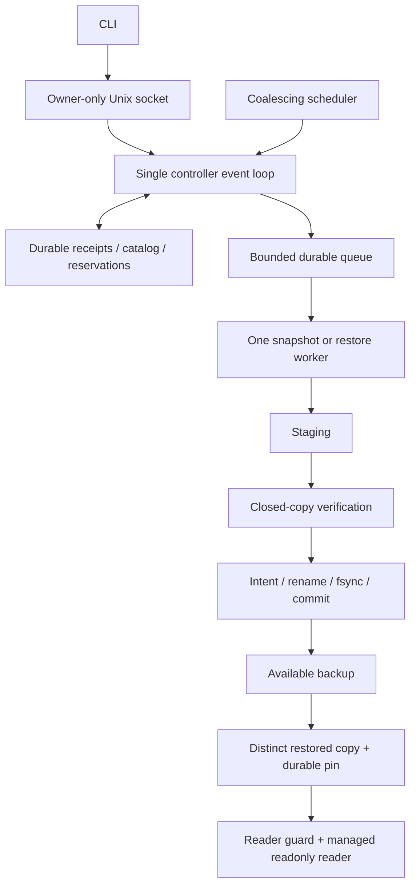

# Operational MVP architecture decisions

This is the historical broader service design. See [CLOSEOUT.md](CLOSEOUT.md)
for the delivered bounded MVP; scheduler, age retention, automatic metadata GC
and systemd packaging remain deferred.

Status: reviewed target architecture. The backup-request portion is implemented
in [PHASE1.md](PHASE1.md); remaining service capabilities are not qualified here.
This document governs the complete next MVP; ARCHITECTURE.md describes the
exploration core. Historical exploration receipts qualify only that core;
phase-one receipts qualify their declared backup-request subset. The repository
is now Public; project-owned material is now [MIT licensed](../LICENSE). Design text is not a pass receipt.

## Scope and invariants

One registered local WAL-mode SQLite database, trusted same-UID processes, owner-only
Unix socket/store, one controller, one heavy operation and one restored reader.
No root in normal use. Source replacement while active is unsupported. No source
replacement during restore, arbitrary SQL/plugins, remote storage or hostile-worker
sandbox. Supported runtime preflight remains mandatory.

- An accepted request has a durable receipt before acknowledgement or work.
- A forgotten request cannot become a new operation by retrying its old envelope.
- Only closed, independently verified copies become AVAILABLE.
- Unknown processes, objects and reservations remain occupied until reconciled.
- No backup/restore with a live or uncertain reader is reclaimed.
- Last/latest usable backup survives rotation; lack of fresh backups is visible.
- Catalog/filesystem write failures stop mutations; diagnostics are not readiness.

## D1. Service and bounded control plane

Use a persistent controller and Unix-domain socket with owner-only permissions.
CLI transports requests; it does not acquire a competing controller lock. SQLite
connections are owned by the serialized controller, never shared across fork.
Copy/validation runs in bounded child work so status/cancel are not trapped behind
a slow copy. Reader processes inherit only their restore guard, never the global
writer lock. Copy workers retain the existing inherited global lock through exit.

Initial design limits (configurable within validated bounds, not measured sizing):
16 queued requests, one active heavy operation, one reader/restore instance,
128 receipts per generation, 64 KiB request frame and eight simultaneous clients.
Reject oversized frames, time out incomplete clients, bound response pages and
logs. Queue admission reserves a receipt; storage reservation is persisted at
dispatch after policy/space recheck. QUEUED means accepted work, not guaranteed
space or success. Requests are never silently dropped when the queue fills.
Read-only status is separate from readiness and remains possible in DEGRADED mode.
Cancel and release/stop of an existing instance use idempotent transitions in that
existing record, with operation/instance identity and epoch/resource revision; they
do not allocate a new heavy queue or receipt slot. Pause uses the bounded authority
record. Repeated requests return the existing outcome where retained, otherwise
reject stale state; they cannot create new work. This control path is still bounded
by frame/client limits and durable-write availability: storage failure cannot be
bypassed merely to acknowledge cancellation. Generation saturation must not make
status/cancel or safe release impossible.

## D2. Deduplication, revisions and bounded history

Do not use an evicting map of arbitrary IDs. A mutation envelope contains durable
controller epoch, receipt generation, request ID, command, canonical argument
digest and any expected policy/resource revision. The generation is a persisted,
monotonically increasing namespace. The CLI saves the envelope before submission;
retry resends it unchanged, and never silently replaces stale tokens.

New-work admission ordering under the single writer:
1. Validate bounded framing and caller access.
2. Look up the exact existing receipt, including retained prior generations. Same
   ID and digest returns its existing status; different digest is a conflict.
   This replay lookup has no side effects and precedes stale-token rejection.
3. With no receipt, reject old epoch/generation. A retired namespace is EXPIRED /
   RESULT_GONE, never permission to execute again. Future namespaces are invalid.
4. Validate command preconditions, queue and receipt capacity; atomically persist
   receipt + queued command before acknowledging acceptance.

Rollover closes admission to a generation, waits for every operation to be terminal
and every associated occupancy reconciled, and durably advances the generation
in one catalog transaction before deleting its receipts. Keep at most one retired receipt generation; older
results may be unavailable. Retired namespace rejection survives their deletion.
Artifacts and active restore references are independent records, never removed
just because their request receipt expires. Do not admit more requests if an
unresolved operation prevents rollover. Status exposes this blockage.

On restart, increment authority epoch after acquiring the global lock. Recover
admitted operations; cancel QUEUED work as INTERRUPTED (do not replay schedules).
Open a fresh admission namespace only after reconciliation. Prior receipts remain
queryable while retained; clients may explicitly submit new intent after inspecting
results, but there is no exactly-once promise across a newly minted envelope.

Separate admission CAS from execution fencing: a queued operation retains its
operation ID and current attempt authority. It does not reapply its old global
revision after its own progress or unrelated completions changed that revision.
Recheck source/config version, target identity, pins and capacity at dispatch.
Policy changes invalidate affected queued work explicitly. Pause/config/release
commands use current resource revisions; old helpers cannot mutate catalog state.

## D3. Cancellation and publication boundary

Cancellation wins only if its durable CANCEL_REQUESTED transition precedes the
PUBLISHING intent in the serialized writer. Worker exit/reaping and directory
cleanup must finish before CANCELLED. Unknown exit => CLEANUP_PENDING with retained
reservation. A cancellation after PUBLISHING returns TOO_LATE and the operation
continues/reconciles to its actual result; never acknowledge successful cancellation
and then publish during recovery. Client disconnect is not cancellation. Timeout
has the same boundary; a deadline after publication intent is not proof of failure.

## D4. Restored-reader ownership and handoff

Restore creates a distinct verified copy and a durable source-backup pin. Only the
managed fixed-profile readonly reader is supported. No external-reader attachment
or promise that a raw exported path has tracked ownership.

Use a fixed per-instance guard inode in a separate guard directory. The controller
acquires an exclusive flock on a fresh open-file description before spawning the
reader. It persists STARTING plus pin and intended instance identity before spawn,
then explicitly passes that locked descriptor to the exec-started reader. The
reader retains it through actual process exit, opens/verifies the exact instance,
and sends a bounded readiness handshake. Controller closes its copy after handoff;
it never calls LOCK_UN. No gap between spawn and reader lock acquisition exists.
On spawn/exec failure or handshake timeout, close the parent transfer FD too, then
use a separate open to attempt cleanup ownership; do not hold an accidental self-lock.
Missing handshake does not prove exit. Record cleanup-required and retain the pin.

For release or recovery, open the guard separately and obtain a nonblocking
exclusive lock before deleting any files. If busy, report BUSY / reader-unknown,
keep files/pin, and do not launch another reader. Do not kill a PID read from stale
metadata; child identity must be proven. If lock acquired, hold it through durable
RELEASING, deletion + directory sync and durable RELEASED/pin decrement. The single
controller prevents competing starts. Reader locks do not prevent global controller
recovery. A lock-free restored instance may be reconciled to READY_STOPPED after
verification; reader restart is explicit, not inferred from the old READY label.

Object/instance IDs come from a persisted monotonically increasing allocator in
the registered store namespace; allocation is durable before filesystem creation.
Never decrement/reset the allocator after tombstone GC; overflow refuses admission.
Missing/corrupt allocator refuses startup, not reinitialization. An old missing ID
returns GONE and cannot create a guard or object.

Guard inodes must not be replaced while an instance might exist. Their bounded
reclamation requires RELEASED committed, no child/FD remaining and exclusive guard
ownership; this same interval retires the instance ID permanently. A crash at any
step must resume known cleanup or retain unknown occupancy, never create a new
lock at the same live identity.

## D5. Capacity, retention and freshness

Keep logical bytes, allocated bytes, free space, active reservations and source WAL
observations distinct. Admission is soft policy; hard enforcement needs a separate
filesystem/quota. Source DB/WAL are outside managed bytes. Disk space checks can race
with other writers. Any storage failure retires mutation authority, including errors
during release/delete/fsync, not only catalog transactions.

Define keep_count >= 2 as the steady-state count target, not a guarantee of two
backups during failed rotation. Always retain the latest usable backup and every
pinned object. Older unpinned objects are deletion candidates if over keep_count OR
over max_age; count and age are upper retention targets with explicit protection
exceptions. A new backup may prune eligible older objects first; report those
committed deletions even if the new copy fails. Never delete protected objects to
satisfy a quota. If no permissible slot/bytes exist, refuse and report the reason.

Count order uses durable publication sequence, not wall clock. Automatic age pruning
uses only elapsed monotonic time observed in the current controller lifetime; after
restart, conservatively restart the age timer for retained objects. This may retain
objects longer, never expire them prematurely due to a clock jump. Report wall-clock
age for information with clock uncertainty; it is not the deletion authority.
Persist snapshot UTC, controller/boot identity and observed clock uncertainty for
reporting; raw monotonic timestamps are never interpreted across boots.
Freshness is a separate status: last successful backup, snapshot start, last attempt,
last failure, overdue/unknown, protected bytes and blocked scheduler reason. Restart
without a new successful backup reports freshness UNKNOWN until re-established;
repeated restarts cannot present an old backup as fresh.

Scheduler uses monotonic intervals; one pending scheduled intent at most. Missed
intervals coalesce, with no catch-up flood. Restart schedules at most one new attempt
after recovery. Bounded cooldown on repeated failure and an explicit pause state
prevent a full disk from causing a retry storm. Manual and scheduled work share
capacity; status and cancellation have a separate bounded control path. Releasing
a blocking pin schedules at most one coalesced retry, subject to pause/cooldown.

Metadata is bounded too: receipt rollover does not reclaim referenced catalog rows.
Delete/release terminal object rows only after file/guard cleanup is durable and no
receipt or active reference needs them; IDs are never reused. Use bounded paged
maintenance, reusable SQLite free pages and declared file/log caps. No automatic
VACUUM requiring an unbudgeted second catalog. If cleanup cannot progress, refuse
new work and report capacity exhaustion rather than claim unlimited longevity.

## D6. Verification labels and scope

The first service MVP remains ledger-v1 only. A generic SQLite/profile interface is
deferred; this review does not approve support for arbitrary schemas. Record three
independent results: snapshot/copy provenance, structural verification, application
verification (profile ID/version). For ledger-v1, all are required for AVAILABLE /
READY. Never call a hash alone application correctness or prove snapshot semantics
by hashing different raw SQLite layouts. Missing/wrong profile refuses admission.

A future generic mode would explicitly report application verification NOT_RUN,
define an identity and snapshot comparison contract, bound queries/temp space and
qualify extension/schema handling separately. Existing HTTP checks establish only
the fixed readonly query; not successful production database replacement.

## Implementation gates

Implement in order: durable request protocol/cancel boundary; restore guard handoff;
bounded scheduler/retention/metadata lifecycle; packaged service and fault tests.
Review each gate against MVP_ACCEPTANCE.md before broadening functionality. No VM
reboot, sudden power loss, boot-zero-gap, physical-storage or long-term-growth claim
follows from architecture review or the existing four exploration receipts.

## Qualified subset after phase two

PHASE2.md is authoritative for the implemented one-reader subset. READY is its
READY_STOPPED equivalent. It conservatively retains UUID identities, restore rows
and fixed guard inodes under finite receipt/catalog caps; the monotonic allocator
and guard/tombstone GC described above remain future targets. Reader mutations use
explicit epoch/revision fencing, not backup-request receipt deduplication. Forced
orphan adoption, service packaging and scheduling remain unimplemented.

## Bounded delivery boundary

[CLOSEOUT.md](CLOSEOUT.md) defines the current local MVP and its separate installed
workflow, capacity, resource and normal reboot evidence. Broader scheduling,
age-retention, automatic metadata GC and systemd packaging designs above are
deferred targets, not implied delivered features. Abrupt power loss and boot
zero-gap remain unqualified.
