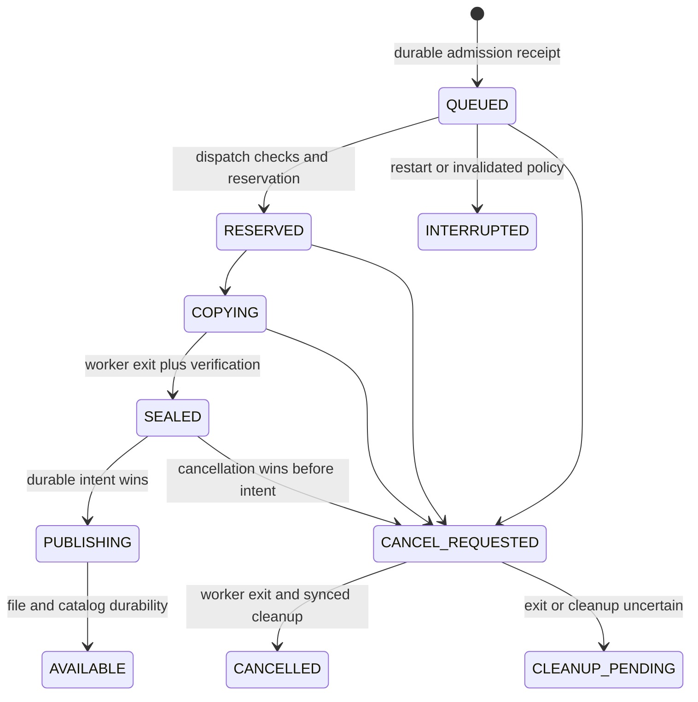

# Planned service state machines and failure recovery

Target state machines. The first backup-request subset is implemented as described
in PHASE1.md; restore-reader and full service transitions remain design only.
These diagrams are not execution evidence.
See MVP_DESIGN.md for decisions and MVP_ACCEPTANCE.md for qualification gates.

## Controller

`LOCK_WAIT -> RECOVERING -> READY <-> PAUSED`

Any uncertain mutation/storage failure: `READY/PAUSED/RECOVERING -> DEGRADED`.
DEGRADED permits bounded diagnostics, not mutation or a readiness-success response.
Repair is external/explicit followed by a new locked lifecycle and reconciliation;
resume is not a storage-repair bypass. PAUSED blocks dispatch/scheduler, not status,
cancel or safe release. Pause state persists; an already active operation is not
implicitly cancelled. Stop closes admission, cancels pre-publication work, and
allows committed publication reconciliation; unknown exit retains locks/occupancy.

## Request and backup

Failures before intent become FAILED only after ownership/cleanup is reconciled.
Uncertainty during PUBLISHING remains recoverable pending, never FAILED merely
because the caller timed out. Cancellation after intent is TOO_LATE. AVAILABLE
artifact deletion uses `AVAILABLE -> DELETING -> DELETED`, independent of receipt
GC. Cancellation cannot undo committed retention deletions; expose them in status.

## Restore and reader

`QUEUED -> MATERIALIZING (pin + reservation) -> READY_STOPPED`

`READY_STOPPED -> STARTING (guard held before spawn) -> SERVING`

`STARTING/SERVING -> ORPHAN_BUSY` if a restarted controller cannot establish reader
control but guard remains held. Keep pin/files/bytes. No automatic second reader.
`SERVING -> STOP_REQUESTED -> READY_STOPPED` only after proven process exit/guard
acquisition. Starting succeeds only after an actual readonly HTTP response matches
instance identity, profile and snapshot; a ready-file/PID is insufficient.

`READY_STOPPED -> RELEASING -> RELEASED` under exclusive guard, with deletion sync
before durable pin decrement. A busy release returns pending/busy without deleting.
Unknown partial restore requires guard inspection too; no cleanup path bypasses it.
A new controller does not send signals to an unverified PID. MVP can wait for an
orphan to exit; remotely controlling an orphan needs separately qualified identity.

## Recovery matrix

| Failure point / durable evidence | Permitted action | Forbidden inference / acceptance observation |
|---|---|---|
| Before admission commit | No operation; same current-envelope retry can admit once | No pruning or child before receipt |
| Receipt committed, response lost | Return existing receipt and operation | No second reservation/prune/worker |
| QUEUED at restart | Persist INTERRUPTED, free queue slot only | Do not silently replay scheduled work |
| Old worker alive after owner death | Remain LOCK_WAIT/BUSY | No takeover by elapsed timeout |
| COPYING without intent, worker exited | Clean known staging and terminalize | Unknown directories are not free space |
| CANCEL_REQUESTED before intent | Reap then clean; CANCELLED only after sync | Recovery must not publish |
| PUBLISHING intent before cancel | TOO_LATE; verify stage/final and finish same ID | Lost reply is not proof of nonpublication |
| Renamed object, catalog not AVAILABLE | Reverify against durable intent and commit | No duplicate or trust of filename alone |
| Generation rollover commit before GC | Retired key rejected or retained receipt returned | GC cannot reopen old namespace |
| Crash during terminal row/file cleanup | Reconcile known cleanup under locks | Never reuse object IDs or delete references |
| Pin committed before copy/spawn | Retain/reconcile pin; acquire instance guard before cleanup | No release based on missing ready signal |
| Spawn/exec before ready handshake | Busy guard => retain; real query needed for SERVING | Missing PID/handshake does not prove exit |
| Controller dies, reader serves | Recover controller; ORPHAN_BUSY for instance | Reader must keep serving; no duplicate reader |
| DELETING with unlink/sync failure | Keep attribution pending; sync parent even when files absent, then commit DELETED | File absence or leaving AVAILABLE does not prove completed deletion |
| RELEASING interrupted before/after unlink | Acquire guard; finish sync and pin decrement once | Do not decrement pin twice |
| ENOSPC/EROFS/SQLite FULL/fsync error | DEGRADED, stop mutations, retain uncertainty | Diagnose is not READY; no fake success |
| Catalog missing/corrupt or unknown inventory | Refuse writable startup, preserve data | Never auto-create empty catalog |
| Pinned older object + protected latest fill capacity | Refuse new work, show stale/blocked, bounded retry | Never evict protected object |
| Restart/clock jump | Latest by sequence; conservative age/freshness unknown | No mass expiry or catch-up flood |

## Review findings and implementation debt

Two independent read-only reviewers inspected current source and exploration docs
before discussing concrete protocol choices. This is design/source review, not a
new runtime test or proof that the service exists.

- The pre-phase-one backup() pruned before _new() checked receipt capacity.
  Source inspection showed a delete-then-refuse path with keep=2/max_receipts=2.
  Phase one repairs and regression-tests this ordering; see PHASE1.md. Durable
  admission and predictable feasibility checks precede pruning; retention belongs
  to the accepted operation and its attribution survives controller death.
- The pre-phase-two release/recover used a caller-stop contract. Phase two now
  requires a separate lifetime reader guard for release/recovery; legacy live
  restores without guards refuse automatic reconciliation. See PHASE2.md.
- Existing global revisions change with operation phases. Do not reuse admission
  revision as a blanket dispatch precondition.
- Historical exploration receipts do not qualify API dedup/GC or durable API
  cancel-vs-publish behavior; phase-one evidence qualifies that new subset separately.
- Generic schema support is deferred. Existing ledger evidence cannot qualify it.

One managed reader is implemented in PHASE2.md. Orphan adoption, generic profiles
and full service operation remain pending.
Historical exploration receipts and measurements are unchanged; phase-one fixes
and evidence are separate and do not imply those remaining capabilities passed.
