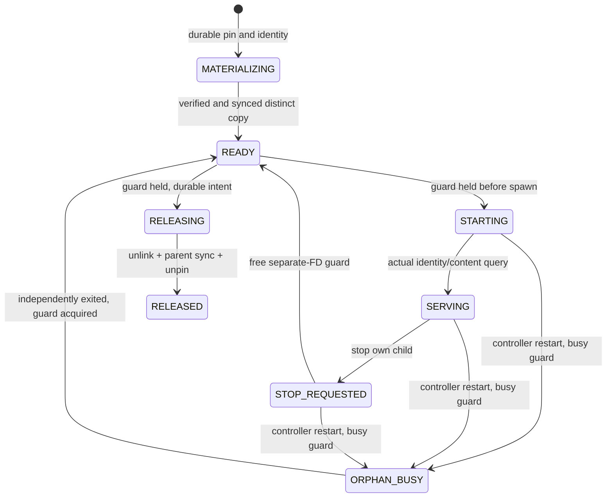

# One restored copy and a managed read-only process

The phase-two results below are historical source-bound qualification of this
lifecycle. Later clean installation, capacity/resource and normal-VM-reboot
receipts are described separately in [CLOSEOUT.md](CLOSEOUT.md).

This slice delivers restore → start → query → stop → release for one `ledger-v1`
copy and one reader. The existing request service and built package run the same
core. It does not replace the live database or supervise arbitrary applications.
Private repository; project-owned material is [MIT licensed](../LICENSE).

## Decisions and invariants

1. The catalog commits a source-backup pin and MATERIALIZING instance before copy.
   The copy is independently hash/content verified; file, directory and parent
   are synced before READY. The source and published backup remain unchanged.
2. Each instance has a fixed inode in `guards/`. It is created exclusively after
   the catalog identity exists and never removed/recreated. Restore tombstones
   remain in the bounded catalog/receipt accounting; UUID collision fails rather
   than reusing an existing identity. There is no guard/tombstone GC in this slice.
3. Start acquires a separate-open-description exclusive instance flock **before**
   spawning. Only that FD is inherited by the reader, not the global writer lock.
   The parent closes its FD; it never explicitly unlocks the inherited description.
   The reader holds it through actual process exit. A ready file is only a hint:
   SERVING requires a real HTTP query with instance nonce, UUID, count and watermark
   matching the verified snapshot. The fixed query uses read-only SQLite handles.
4. A busy instance guard retains the copy, pin and measured bytes even if status,
   PID or HTTP readiness is missing. Controller takeover remains possible because
   the reader does not hold the global lock. It becomes ORPHAN_BUSY, never a second
   reader or an automatic deletion candidate.
5. Stop signals only the current controller's own unreaped Popen child. A two-second
   wait timeout means STOP_REQUESTED, **not death**. A restarted controller never
   signals a persisted PID; an orphan must exit independently before stop/release
   can establish a free guard. There is no forced orphan adoption/termination API.
6. Release acquires the instance guard through RELEASING, deletion, parent fsync,
   durable RELEASED and exactly one pin decrement. If deletion or fsync fails,
   uncertainty remains charged and the controller blocks mutations. Recovery
   retries parent sync even if the directory is already absent. Capacity/receipt
   admission does not run for stop/release; no new operation slot is needed.

A trusted same-UID process can ignore this protocol or alter local files. External
unmanaged readers are outside the guard guarantee. Older READY copies created
before guards existed refuse writable startup; stop all old readers and reconcile
such a store offline. No automatic migration pretends an old reader owns a guard.

## Actual state machine



READY means stopped/guard-free, not an HTTP readiness claim. Recovery cleans an
interrupted MATERIALIZING or completes RELEASING only with a free guard. Unknown
occupancy is retained. On graceful controller shutdown, readers deliberately
remain alive just as after controller crash: explicitly stop/release them first
when a fully stopped deployment is wanted. This slice is not a systemd package.

## Use the persistent service

Use a canonical absolute owner-only store path and the fixed demonstration source.
Install the package with a qualified linked SQLite runtime as described in README.
Do not run the synchronous CLI against an already-running controller.

```sh
python -m keepweft.service --root /absolute/store \
  --source /absolute/live.sqlite --uuid RETURNED_UUID
# In another terminal: existing backup prepare/submit/lookup workflow, PHASE1.md.
python -m keepweft.client status --root /absolute/store
```

Status returns total backup/restore counts, recent 16 rows plus active restores
and pinned backups, and an explicit `history_truncated` flag. It omits manifests
and operation history so retained history cannot prevent fetching a stop/release
token through the bounded socket frame. Managed-byte accounting still walks all
files; the abbreviated list never marks omitted occupancy free.

Reader actions use `action=reader`, `args={command,id,token}` on the same owner-only
Unix socket. Mutation requires the **explicit current** `{epoch,revision}` from
`status.result.inventory.token`. Save that object as `token.json` before an action;
refresh it after a successful mutation. This prevents a delayed retry overwriting
new state. The token file contains no secret but should stay local.

```sh
python -m keepweft.client reader --root /absolute/store \
  --command restore --id BACKUP_ID --token token.json
# Read the returned restored instance ID and refresh token from status.
python -m keepweft.client reader --root /absolute/store \
  --command start --id RESTORE_ID --token token.json
python -m keepweft.client reader --root /absolute/store \
  --command query --id RESTORE_ID
# Refresh token; stop; refresh token; release.
python -m keepweft.client reader --root /absolute/store \
  --command stop --id RESTORE_ID --token token.json
python -m keepweft.client reader --root /absolute/store \
  --command release --id RESTORE_ID --token token.json
```

Unlike backup envelopes, reader mutations currently use revision fencing, not a
separate durable request receipt. If a response is lost, inspect inventory and
query existing state first. An old token refuses; fetching a new token is an
explicit new decision, not an automatic retry. One-copy enforcement prevents
concurrent restore duplication. Release after RELEASED refuses without decrement.

The reader binds only loopback and requires its per-start bearer nonce, stored
under the owner-only store; the controller supplies it. HTTP authentication is
not a multi-user identity/RBAC boundary. There is no arbitrary SQL, write endpoint
or external-network listener. Accepted HTTP connections have a 0.5-second socket
inactivity limit, including incomplete headers before authentication. The reader
closes idle requests so a silent local client cannot occupy it indefinitely. This
is not a total request deadline, parallel-server claim or DoS guarantee: continuous
slow input and repeated connections may still interfere. Synchronous verification, stop and filesystem calls
can delay control responses; there is no universal status/cancel latency SLO.

## Fault acceptance and evidence

- Same formal service tests on macOS and installed Linux; package/source hashes
  and linked SQLite runtime must agree with the frozen manifest.
- SIGKILL before spawn: free guard returns READY; after spawn: actual reader keeps
  the guard, controller recovers globally and retains ORPHAN_BUSY/pin.
- Kill controller while the actual reader is held before writing readiness: no
  handshake still means ORPHAN_BUSY. A held readiness deadline returns TimeoutError,
  preserves the pin and permits explicit stop/release. In the controlled successful
  kill trial, a separate-FD free guard and absent owned PID must both be observed
  **before any stop**, independently proving exit/reaping. A separate injected
  ineffective-kill test retains the live child, busy guard, copy and pin; release
  refuses until a later stop actually proves exit.
- Serving reader survives controller SIGKILL and answers the fixed snapshot.
  Duplicate start/restore and live release reject. Stale epoch returns an explicit
  authority rejection; stale revision and missing token also reject with a **free**
  guard, so a busy-reader refusal cannot mask a broken authority check.
- SIGSTOP preserves occupancy; owned-reader stop timeout is not successful exit.
  Only actual independent exit permits stop reconciliation and release.
- Kill at durable release intent; recovery deletes and unpins once.
- Real Linux readonly bind mount causes EROFS 30, keeps pin/copy, and prevents
  restart until repair. After unmount, formal recovery completes deletion/unpin.
- A real unauthenticated incomplete HTTP header must receive server EOF before
  the test closes its socket; normal query/stop/release still work afterwards.
- Unit tests inject exec, wrong readiness query, ineffective kill, unlink and parent-sync failures.
  Injection is labelled separately from actual VM filesystem fault evidence.
- Logical-byte/receipt exhaustion must not require another admission slot to stop
  and release a known reader. Metadata/guards are conservatively retained; finite
  catalog/receipt exhaustion remains possible, not long-term rollover qualification.

[Current JSON/HTML and measurements](../evidence/phase2/README.md). Timings include
the test client’s preliminary status/token RPC, socket/process scheduling, and
receipt of the start response after the real loopback readiness query; RSS is a point sample from
Linux `/proc/.../status`, native test samples use `ps`. The published observations
are isolated-VM-only, not peaks, long-run growth, native comparisons or guarantees.

## Reproduce

Build a current wheel, then invoke the dedicated runner. It creates only a fresh
`keepweft-exp-*` profile without host mounts, installs the wheel, moves uploaded
product source out of import reach, checks module/library hashes, runs both full
portable suites and VM cases, records all stage exit codes/timeouts and deletes
its own VM/data disk even after failure. External preexisting profiles are checked.

```sh
.venv/bin/python -m pip wheel --no-deps --no-build-isolation \
  --wheel-dir results/phase2-wheel .
.venv/bin/python -m tools.phase2_validate \
  --colima-home /absolute/dedicated-colima-home \
  --toolchain /absolute/colima-toolchain \
  --profile keepweft-exp-p2-UNIQUE \
  --wheel results/phase2-wheel/keepweft-0.1.0-py3-none-any.whl \
  --output results/phase2-UNIQUE
```

Needs a working Colima/Lima/QEMU toolchain, network access for guest packages and
SQLite source, and permission to create local sockets. Raw logs contain local
paths and remain ignored. Export only reviewed sanitized receipts. A timeout,
skip, failed assertion, missing case or cleanup failure never becomes a pass.

VM reboot, sudden power loss, physical storage, production cutover, orphan
adoption, arbitrary profiles, scheduler, age retention and long-term guard/metadata
GC remain unqualified.


## Later bounded closeout

The earlier qualification boundaries above remain historical and source-bound.
[Bounded closeout](CLOSEOUT.md) defines the delivered local MVP, its installation
workflow, policy-capacity and resource checks, and separate normal-VM-reboot
qualification. Earlier scheduler, age-retention, general metadata GC and systemd
packaging targets are deferred; they are not prerequisites added to this closeout.
No sudden-power-loss, boot zero-gap or unlimited-longevity claim is made.
